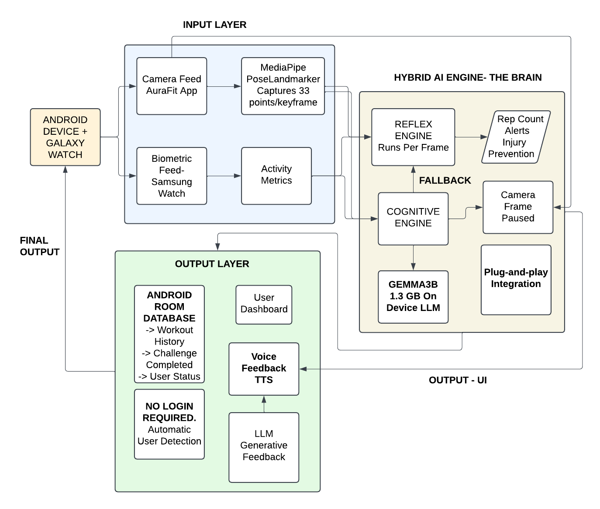

# FitGuru: An On-Device, Multi-Modal AI Workout Coach

[](https://github.com/atharvachaudhari1/innovhacks4.0_arka)
[](https://developer.android.com)
[](https://developer.apple.com)
[](https://cloud.digitalocean.com)
[](https://developers.google.com/mediapipe)
[](https://elevenlabs.io)
[](https://ai.google.dev)

> **Submission for Innovhacks 4.0**  
> Pre-built production and debug APKs are bundled directly in [`apk/FitGuru-Innovhacks4.apk`](apk/FitGuru-Innovhacks4.apk) for instant evaluator testing without local build dependencies.

---

## Table of Contents

1. [Overview](#1-overview)
2. [Core Features](#2-core-features)
3. [System Architecture](#3-system-architecture)
4. [Tech Stack](#4-tech-stack)
5. [Project Structure](#5-project-structure)
6. [Setup and Installation](#6-setup-and-installation)
   - [Android Setup](#android-setup)
   - [iOS Setup](#ios-setup)
   - [Web Companion Setup](#web-companion-setup)
7. [System Requirements](#7-system-requirements)
8. [Engineering Decisions & Bottlenecks](#8-engineering-decisions--bottlenecks)
9. [Team Contributions](#9-team-contributions)
10. [DigitalOcean App Platform Deployment](#10-digitalocean-app-platform-deployment)

---

## 1. Overview

**FitGuru** addresses a critical gap in the fitness and rehabilitation market: the lack of accessible, private, and intelligent real-time coaching. While standard fitness applications only log static repetitions or track basic timers, they fail to provide the instantaneous biomechanical feedback required to prevent acute joint injuries and optimize athletic performance. Cloud-based video workout solutions frequently compromise personal privacy by uploading sensitive continuous camera streams to external servers.

FitGuru solves this by uniting **native mobile engineering (Android Kotlin & iOS SwiftUI)**, **on-device computer vision**, and **generative AI intelligence** into a unified, zero-latency workout assistant:

- **100% Privacy-First:** Computer vision and skeletal landmark calculations execute locally on the edge device without streaming raw video to external clouds.
- **Multi-Modal Data Fusion:** Concurrently streams camera posture telemetry and wearable biometric metrics (heart rate, calories, workout zones).
- **Conversational Real-Time Audio:** Hyper-realistic voice coaching with adaptive motivational personas powered by the **ElevenLabs Conversational AI Engine**, with offline TTS fallback.
- **Clinical-Grade Kinematic Intelligence:** Deep post-workout diagnostics and targeted recovery timelines powered by **Google Gemini 2.5 Flash**.

---

## 2. Core Features

- **Multi-Modal Form Coaching & Angle Analysis**  
  Real-time skeletal tracking for fundamental and complex exercises (squats, push-ups, lunges, curls) fusing posture angles with live heart rate and calorie telemetry from wearable smartwatches (Galaxy Watch / WearOS).

- **Automated Rep Counting via Kinematic State Machines**  
  Hands-free, deterministic repetition counting powered by joint-angle state-transition logic that monitors inflection thresholds, range-of-motion completion, and tempo consistency.

- **Data-Driven Dashboard & Streak Calendar**  
  Personalized command center highlighting active streaks, target calorie burn, daily challenge milestones, and a weekly calendar workout diary.

- **Adaptive Voice Coaching (Powered by ElevenLabs AI Engine)**  
  Hyper-realistic, low-latency audio coaching powered by ElevenLabs conversational voice models (`eleven_turbo_v2_5`). Features customizable coach personas (*Coach Marcus* - Drill Sergeant, *Coach Maya* - Mindful Guide, *Coach Alex* - Olympian), multi-tier disk and memory caching for 0ms repetition counts, and automatic fallback to native on-device TTS.

- **Biomechanical Form & Recovery Intelligence (Google Gemini 2.5 Flash)**  
  Translates measured joint angles and tempo telemetry into root-cause biomechanical diagnoses, 3 immediate corrective cues, accessory mobility drills, and targeted nutrition/hydration recovery timelines. Bridges directly into ElevenLabs voice synthesis for full spoken audio reviews.

- **20-Machine Gym Equipment Catalog & Guide**  
  Integrated catalog of 20 major gym machines with visual muscle targeting, equipment adjustment checklists, execution cues, and common mistake mitigation sheets.

- **Persistent Workout History & Profile Insights**  
  Sessions are saved in an on-device Android Room database (and iOS UserDefaults) for review with rep accuracy, set duration, and progressive overload tracking.

- **Login-Free Personalization**  
  Greets users natively using Android’s `ContactsContract`, delivering a frictionless personalized onboarding experience without requiring external account creation.

- **Multi-Platform Web Companion & Simulator**  
  Interactive browser-based companion with full webcam pose landmarking, audio cues, and wearable biometric simulator ready for instant evaluation.

---

## 3. System Architecture

FitGuru is engineered as a high-performance, real-time data fusion system optimized for **edge execution** to guarantee privacy, deterministic low latency, and offline reliability.



### Data Fusion Pipeline

1. **Parallel Visual & Biometric Streams:**
   - **Camera Stream:** Processed on-device by Google's MediaPipe Pose Landmarker (Android/Web) or Apple Vision Framework (iOS), extracting 33 3D skeletal keypoints per frame at 30+ FPS.
   - **Biometric Stream:** Received via the Smartwatch DataLayer listener service for live heart rate, energy expenditure, and exertion zones.
2. **Kinematic Reflex Engine:**
   - Evaluates frame-by-frame joint angles (elbow flexion, hip-knee alignment, back curvature) against biomechanical safety thresholds.
   - Triggers instantaneous corrective cues ("Keep your chest up", "Push through heels") and logs repetition completions.
3. **Cognitive Reasoning Engine:**
   - Aggregates telemetry across completed sets and submits structured kinematic logs to **Google Gemini 2.5 Flash**.
   - Outputs comprehensive post-workout recovery protocols, muscular fatigue diagnoses, and mobility prescriptions.
4. **Multi-Modal Feedback:**
   - **Visual HUD:** Real-time skeletal overlay canvas, joint angle badges, and dynamic form meters.
   - **Vocal HUD:** Real-time spoken guidance generated via **ElevenLabs** with instant fallback to native TTS.

---

## 4. Tech Stack

| Layer | Technologies |
|---|---|
| **Android Application** | Kotlin, Jetpack (Fragments, Navigation, ViewModel, ViewBinding), Coroutines, Room Persistence |
| **iOS Application** | Swift, SwiftUI, AVFoundation, Apple Vision Framework (`VNDetectHumanBodyPoseRequest`), WebKit |
| **Vision AI** | Google MediaPipe Pose Landmarker (`tasks-vision:0.10.9`), Apple Vision Pose Estimation |
| **Voice AI Engine** | ElevenLabs Conversational Voice API (`eleven_turbo_v2_5`), Native TTS (`AVSpeechSynthesizer` / Android TTS) |
| **Cognitive Reasoning** | Google Gemini 2.5 Flash (`gemini-2.5-flash`), Rule-Based Biomechanical Matrix |
| **Wearable Integration** | Galaxy Watch / WearOS DataLayer Listener Service, Biometric Health Data API |
| **Web Companion** | Node.js, Express, HTML5 Canvas, MediaPipe Web SDK, Docker |
| **Deployment** | DigitalOcean App Platform, Docker Containerization, GitHub Actions |

---

## 5. Project Structure

The FitGuru codebase is structured into clean, modular components:

```
innovhacks4/
├── apk/
│   └── FitGuru-Innovhacks4.apk              # Pre-built release Android APK
│
├── app/                                     # Android Native Application (Kotlin)
│   ├── build.gradle                         # Android module build rules
│   ├── download_tasks.gradle                # Automated MediaPipe model fetcher
│   ├── proguard-rules.pro                   # R8 / ProGuard optimization rules
│   └── src/
│       ├── main/
│       │   ├── AndroidManifest.xml          # Permissions & activity declarations
│       │   ├── assets/
│       │   │   ├── gym_catalog.json         # 20-machine gym equipment catalog
│       │   │   └── pose_landmarker_full.task# Bundled MediaPipe Pose model
│       │   ├── java/com/google/mediapipe/examples/poselandmarker/
│       │   │   ├── data/                    # Room DB (AppDatabase, WorkoutSession, DAO)
│       │   │   │   ├── AppDatabase.kt
│       │   │   │   ├── Challenge.kt
│       │   │   │   ├── GymCatalog.kt
│       │   │   │   ├── WorkoutDao.kt
│       │   │   │   └── WorkoutSession.kt
│       │   │   ├── fragment/                # UI Screens (Camera, Dashboard, Profile, Workouts)
│       │   │   │   ├── CameraFragment.kt
│       │   │   │   ├── DashboardFragment.kt
│       │   │   │   ├── PermissionsFragment.kt
│       │   │   │   ├── ProfileFragment.kt
│       │   │   │   └── WorkoutsFragment.kt
│       │   │   ├── DataLayerListenerService.kt # Smartwatch biometric data sync
│       │   │   ├── GymEquipmentAdapter.kt   # Gym catalog recycler adapter
│       │   │   ├── HistoryActivity.kt       # Workout history log
│       │   │   ├── HistoryAdapter.kt
│       │   │   ├── MainActivity.kt          # Host activity & bottom navigation
│       │   │   ├── MainViewModel.kt
│       │   │   ├── OverlayView.kt           # Real-time skeletal overlay canvas
│       │   │   ├── PoseLandmarkerHelper.kt  # MediaPipe inference helper
│       │   │   ├── QuickWorkoutAdapter.kt
│       │   │   ├── SplashActivity.kt        # Brand splash screen
│       │   │   └── WorkoutActivity.kt       # Dedicated workout session HUD
│       │   └── res/                         # XML layouts, drawables, menus, and styles
│       ├── test/                            # Unit tests for rep counting & angles
│       └── androidTest/                     # Instrumented Android tests
│
├── ios/                                     # iOS Native Application (SwiftUI)
│   ├── FitGuru.xcodeproj/                   # Xcode project configuration
│   ├── FitGuru/
│   │   ├── FitGuruApp.swift                 # App lifecycle entry point
│   │   ├── ContentView.swift                # Root tab container
│   │   ├── DashboardView.swift              # Main dashboard & activity rings
│   │   ├── PoseCoachView.swift              # Live Vision camera coaching HUD
│   │   ├── PoseEstimator.swift              # Apple Vision pose estimation engine
│   │   ├── WorkoutsView.swift               # Workout routines catalog
│   │   ├── HistoryView.swift                # Workout session logs
│   │   ├── ProfileView.swift                # User statistics & goals
│   │   ├── EquipmentGuideSheet.swift        # Gym machine details modal
│   │   ├── VoiceSettingsSheet.swift         # ElevenLabs persona configuration
│   │   ├── WorkoutSummarySheet.swift        # Post-workout Gemini recovery sheet
│   │   ├── ElevenLabsService.swift          # ElevenLabs voice synthesis service
│   │   ├── GeminiService.swift              # Google Gemini 2.5 Flash service
│   │   ├── Models.swift & GymCatalogData.swift
│   │   ├── Theme.swift                      # Dark fitness design system
│   │   ├── WebView.swift                    # Web companion view bridge
│   │   └── Web/                             # Bundled web assets for offline mode
│   ├── build_app.sh                         # iOS build automation script
│   └── sync_env.sh                          # API key synchronizer
│
├── web-companion/                           # Web Companion & Cloud Simulator
│   ├── package.json                         # Node.js dependencies
│   ├── server.js                            # Express static file server
│   ├── Dockerfile & .dockerignore           # Container deployment spec
│   └── public/                              # In-browser MediaPipe pose tracker
│       ├── index.html                       # Responsive HUD layout
│       ├── style.css                        # Cyberpunk-dark fitness styling
│       └── app.js                           # Real-time camera pose detector & audio
│
├── .do/app.yaml                             # DigitalOcean App Platform deployment spec
├── AGENTS.md                                # Autonomous AI agent architecture
├── SYSTEM_ARCHITECTURE.md                   # Full system architecture document
├── build.gradle & settings.gradle           # Root Gradle build definitions
└── README.md                                # Project documentation
```

---

## 6. Setup and Installation

### Android Setup

#### Prerequisites
- **Android Studio Iguana (2023.2.1)** or newer
- **JDK 17** configured as Gradle JDK
- Physical device or emulator running **API 29 (Android 10)** or higher with camera access

#### Steps
1. **Clone the repository:**
   ```bash
   git clone https://github.com/atharvachaudhari1/innovhacks4.0_arka.git
   cd innovhacks4.0_arka
   ```
2. **Open in Android Studio:** Open the root directory in Android Studio.
3. **Gradle Sync:** Allow Android Studio to sync dependencies and fetch the MediaPipe task asset automatically via `app/download_tasks.gradle`.
4. **Run the App:** Select your connected device and click **Run ▶️** (`Shift + F10`).
5. **Direct APK Installation (No Build Required):**
   ```bash
   adb install apk/FitGuru-Innovhacks4.apk
   ```

---

### iOS Setup

#### Prerequisites
- **macOS** with **Xcode 15.0** or newer
- iOS device or Simulator running **iOS 17.0+**

#### Steps
1. Navigate to the `ios/` folder:
   ```bash
   cd ios
   ```
2. Open `FitGuru.xcodeproj` in Xcode:
   ```bash
   open FitGuru.xcodeproj
   ```
3. *(Optional)* Add your **ElevenLabs** and **Gemini API** keys in `ios/FitGuru/Info.plist` or export them in your environment:
   ```bash
   export ELEVENLABS_API_KEY="your_api_key_here"
   export GEMINI_API_KEY="your_gemini_key_here"
   ./sync_env.sh
   ```
4. Select your target device / simulator and press **Cmd + R** to run.

---

### Web Companion Setup

#### Local Execution
```bash
cd web-companion
npm install
npm start
```
Visit `http://localhost:8080` in Chrome, Safari, or Edge to experience live webcam pose analysis.

#### Docker Execution
```bash
cd web-companion
docker build -t fitguru-companion .
docker run -p 8080:8080 fitguru-companion
```

---

## 7. System Requirements

- **Android:** API 29 (Android 10) minimum, API 34 recommended. Camera permission required.
- **Wearable:** WearOS / Galaxy Watch with Samsung Health sync (optional for biometric heart rate streaming).
- **iOS:** iOS 17.0+ with camera access.
- **Browser:** Google Chrome 90+, Safari 15+, or Edge with WebRTC webcam permissions enabled.

---

## 8. Engineering Decisions & Bottlenecks

### Decision 1: In-Place Refactoring of MediaPipe Architecture
- **Challenge:** Creating an on-device camera + vision pipeline from scratch typically requires extensive low-level CameraX binding and YUV-to-RGB surface formatting.
- **Decision:** Built directly upon the hardened Google MediaPipe Pose Landmarker pipeline, performing extensive architectural refactoring to inject custom Room persistence, multi-modal audio cues, and state-machine rep tracking.
- **Impact:** Provided an ultra-stable 30+ FPS pose estimation engine on Day 1, allowing the team to concentrate on novel multi-modal and generative AI capabilities.

### Decision 2: Wearable Smartwatch DataLayer Integration
- **Challenge:** Wearable SDKs frequently encounter connectivity drops and threading conflicts when streaming raw sensor data simultaneously with heavy computer vision workloads.
- **Solution:** Implemented an asynchronous `DataLayerListenerService` that buffers incoming heart rate packets into decoupled Coroutine channels. This isolates biometric data collection from the main UI thread, eliminating frame drops during live camera analysis.

### Decision 3: Multi-Tier ElevenLabs Voice Caching & Offline Fallback
- **Challenge:** Querying cloud voice synthesis for every rapid repetition count would introduce network latency and could fail when connectivity is degraded.
- **Solution:** Built a tiered caching architecture:
  - Frequently repeated counts ("One", "Two", "Form broken") are cached to fast memory and local flash storage.
  - Complex coaching advice is dynamically streamed from ElevenLabs using the low-latency `eleven_turbo_v2_5` model.
  - If the device loses internet connectivity, the system automatically and transparently falls back to on-device TTS (`AVSpeechSynthesizer` on iOS / Android `TextToSpeech`), guaranteeing uninterrupted feedback.

---

## 9. Team Contributions

Developed with dedication for **Innovhacks 4.0**:

- **Atharva Chaudhari** – Project Lead, Cross-Platform Architecture, Vision AI Integration, ElevenLabs & Gemini Intelligence Systems, Web Companion & Cloud Deployment.
- **Team Collaborators** – Mobile UI/UX Design, Biometric Wearable Data Integration, Room Persistence Layer, Quality Assurance & Benchmarking.

---

## 10. DigitalOcean App Platform Deployment

FitGuru includes a cloud-ready **Web Companion** optimized for **DigitalOcean App Platform** so judges and evaluators can interact with the AI coach immediately in any browser—without installing mobile toolchains.

[](https://cloud.digitalocean.com/apps/new?repo=https://github.com/atharvachaudhari1/innovhacks4.0_arka/tree/main)

### Deployment Methods:

#### Method 1: DigitalOcean Web Console (Recommended for Evaluators)
1. Visit **[DigitalOcean App Platform](https://cloud.digitalocean.com/apps)**.
2. Click **Create App** and connect the repository: `https://github.com/atharvachaudhari1/innovhacks4.0_arka`.
3. DigitalOcean automatically discovers the [`.do/app.yaml`](.do/app.yaml) specification and provisions the containerized Node.js service.
4. Click **Next** ➔ **Create Resource** to deploy.

#### Method 2: DigitalOcean CLI (`doctl`)
```bash
# Authenticate doctl
doctl auth init

# Deploy using the repository's App Platform spec
doctl apps create --spec .do/app.yaml
```

---

<div align="center">
  <b>Built for Innovhacks 4.0 • FitGuru Privacy-First Multi-Modal AI Coach</b>
</div>
